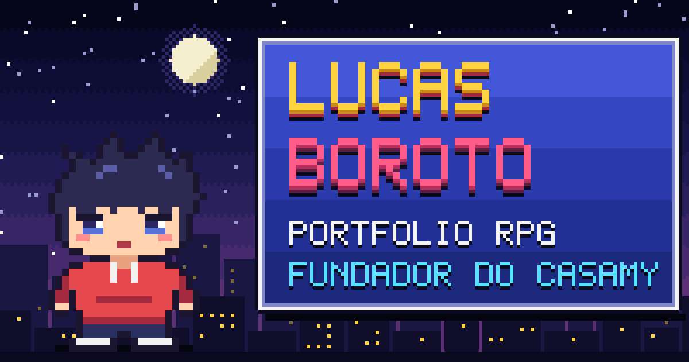

# Lucas Boroto · Portfólio RPG

Meu portfólio em forma de menu de JRPG, em pixel art e 8 bits. Feito do zero com TypeScript, canvas e CSS, sem framework.

**Jogue em https://lucaslangley.github.io**



## Como jogar

| Ação | Teclado | Mouse / toque |
|---|---|---|
| Escolher | ↑ ↓ ← → ou WASD | passar o mouse |
| Abrir | Enter, Espaço ou Z | clicar / tocar |
| Voltar | Esc, X ou Backspace | botão ◀ |
| Som | M | ♪ no topo |

Cada seção aberta vale uma ★. Junte as 5.

E há 7 segredos escondidos, com pistas diferentes no computador e no celular (lá, o que pede teclado vira gesto). A tela **SEGREDOS** mostra quantos você já achou.

## O que tem aqui

- **Sprites desenhados como texto** em [`src/sprites.ts`](src/sprites.ts): cada caractere é um pixel.
- **Cenário em canvas** de baixa resolução ([`src/scene.ts`](src/scene.ts)): céu pontilhado, lua, estrelas, cidade com janelas que acendem, estrelas cadentes e fogos. A cidade muda a cada visita.
- **Sons e música 8-bit gerados no navegador** com WebAudio ([`src/audio.ts`](src/audio.ts)), sem nenhum arquivo de áudio.
- **Transição em blocos**, caixa de diálogo letra por letra e conquistas.
- **Acentos desenhados em pixel** ([`src/accents.ts`](src/accents.ts)): a Press Start 2P encolhe maiúscula acentuada; aqui a letra fica cheia e o acento vai por cima.
- **Rotas por hash** (`#/status`, `#/quests`…), então dá para mandar o link de uma seção direto.
- Respeita `prefers-reduced-motion` e funciona com leitor de tela, teclado, mouse e toque.

## Mudar o conteúdo

O site é bilíngue (português e inglês, com bandeiras na tela inicial e opção em OPÇÕES). O texto de cada idioma fica em [`src/i18n/pt.ts`](src/i18n/pt.ts) e [`src/i18n/en.ts`](src/i18n/en.ts), com a mesma estrutura: o TypeScript avisa se faltar alguma chave numa das línguas. Links de contato ficam em [`src/data.ts`](src/data.ts). O layout não precisa ser tocado.

Se entrar texto com caracteres novos (principalmente japonês), rode `npm run fonts` para incluir os blocos de fonte que faltarem. O `npm run build` já faz isso.

## Scripts

```bash
npm install
npm run dev       # servidor local
npm run build     # fontes + checagem de tipos + build em dist/
npm run sprites   # gera .sprite-preview/sheet.png para conferir os sprites
npm run og        # gera public/og.png (prévia de link) e public/favicon.svg
```

## Publicar no GitHub Pages

O workflow em [`.github/workflows/deploy.yml`](.github/workflows/deploy.yml) publica a cada push na `main`.

1. No repositório: **Settings → Pages → Build and deployment → Source: GitHub Actions**.
2. Faça push na `main`. O endereço aparece na aba **Actions** quando o deploy termina.

## Créditos

- Fontes [Press Start 2P](https://fonts.google.com/specimen/Press+Start+2P) e [DotGothic16](https://fonts.google.com/specimen/DotGothic16), sob a SIL Open Font License (licenças em `src/fonts/`).
- Personagem, ícones, cenário, sons e música: originais, feitos para este projeto.
